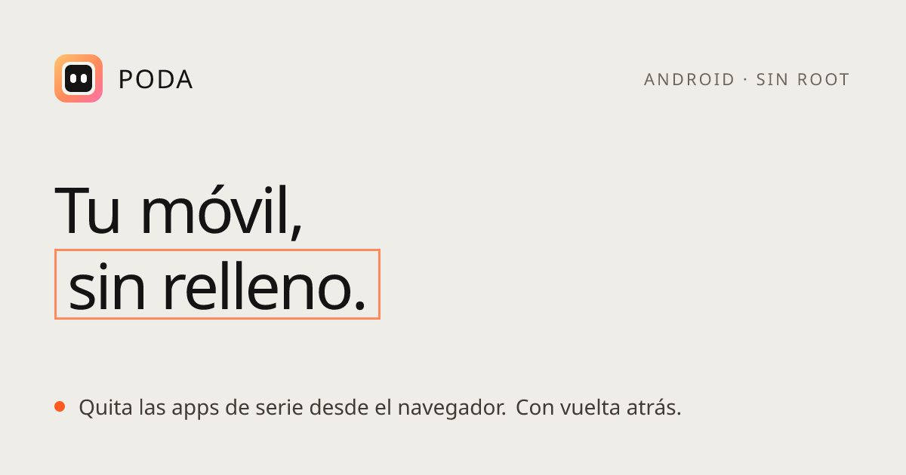

<p align="center">
  <a href="https://podamovil.com"></a>
</p>

<p align="center">
  <a href="README.md">Español</a> · <strong>English</strong>
</p>

<p align="center">
  <a href="LICENSE"></a>
  <a href="https://github.com/RedderLabs/PODA/actions/workflows/ci.yml"></a>
  <a href="https://github.com/RedderLabs/PODA/stargazers"></a>
  <a href="https://podamovil.com"></a>
  
</p>

# PODA

**PODA** stands for *Programa para Ocultar y Desactivar Apps* ("a program to hide and disable apps"). It removes the apps your phone maker and carrier preinstalled on your Android: from the browser, with nothing to install, no root, and fully reversible.

> Poda deletes nothing from the system. It removes apps **for your user** (`pm uninstall -k --user 0`) or disables them. Everything comes back with one click or one command, and a backup is saved before anything changes.

The website and the docs are in Spanish for now. The tool itself works with any Android, whatever its language.

## Start here

| I have… | Go to |
|---|---|
| An Android phone and a computer with Chrome or Edge | **[podamovil.com/conectar](https://podamovil.com/conectar/)**: plug in the cable and go |
| Claude Code (or another assistant that runs commands) | **[The prompt](#with-claude-or-another-assistant)** |
| Android 11+ and no computer | **[Without a computer](https://podamovil.com/sin-pc/)**: Shizuku + Canta, plus Poda's do-not-touch list |
| An iPhone | iOS doesn't allow this. What you *can* delete by hand is in [COMPATIBILIDAD.md](COMPATIBILIDAD.md#apple-iphone-y-ipad) |

## How it works

1. Turn on **USB debugging** on the phone.
2. **Plug it in.** Chrome or Edge talk to the phone over the cable (WebUSB). Nothing leaves your computer.
3. **Poda recognises it**: model, Android version, vendor skin and how many preinstalled apps can go.
4. **Choose how far to go** (safe, recommended or expert), review the list, a backup is saved, and it's applied.
5. **Test the phone, then reboot.** If something's wrong, undo it from the same screen.

Try it without a phone: [podamovil.com/conectar/?demo](https://podamovil.com/conectar/?demo).

## With Claude (or another assistant)

Paste this into Claude Code:

```text
Clone https://github.com/RedderLabs/PODA and follow the instructions in PROMPT.md.
I want to clean my Android phone with the recommended profile.
Detect the brand and model, and show me the proposal with each package explained in plain language.
Before touching anything, save a backup so I can go back.
Don't apply any change until I confirm.
```

The assistant uses Poda's MCP server, which refuses to apply anything without a prior backup and explicit confirmation. Full instructions: [PROMPT.md](PROMPT.md).

## What Poda never touches

The starting list is [Universal Android Debloater Next Generation](https://github.com/Universal-Debloater-Alliance/universal-android-debloater-next-generation). Poda hardens it for non-technical users: system boot and settings, home screen launchers, setup wizards, calls/data/carrier and Google services are **never** touched; keyboard, phone, SMS, contacts, clock, browser, camera and gallery are **expert-only, with a warning**; apps with a launcher icon are **unchecked by default**.

The list lives in [`packages/nucleo/src/protecciones.ts`](packages/nucleo/src/protecciones.ts) and is published as open data at [podamovil.com/protegidas.json](https://podamovil.com/protegidas.json) for any other tool to use.

## If something goes wrong

- [Restore](docs/restaurar.md) · [Phone stuck on the boot logo](docs/rescate.md) (recoverable without wiping) · [Connection problems](docs/problemas.md)

## Contributing

The most useful thing is telling us how it went on your phone (brand, model, Android, profile, result) in an [issue](https://github.com/RedderLabs/PODA/issues/new/choose). See [CONTRIBUTING.md](CONTRIBUTING.md); AI coding agents should read [AGENTS.md](AGENTS.md). Development setup: [docs/desarrollo.md](docs/desarrollo.md).

## Contact

[@redderlabs on X](https://x.com/redderlabs) · [redderlabs.com](https://redderlabs.com) · [Discussions](https://github.com/RedderLabs/PODA/discussions) · [Security](SECURITY.md)

## Legal

Provided as is, without warranty. Changing system apps can affect how your phone works: use it at your own risk, keep the backup and test before rebooting. Poda is not affiliated with or endorsed by Google, Samsung, Xiaomi or any other manufacturer or carrier.

## License

[GPL-3.0-or-later](LICENSE). The app list comes from [UAD-ng](https://github.com/Universal-Debloater-Alliance/universal-android-debloater-next-generation) (GPL-3.0). WebUSB connection via [Tango (ya-webadb)](https://github.com/yume-chan/ya-webadb).

---

<p align="center">A <a href="https://redderlabs.com">Redder Labs</a> product</p>
