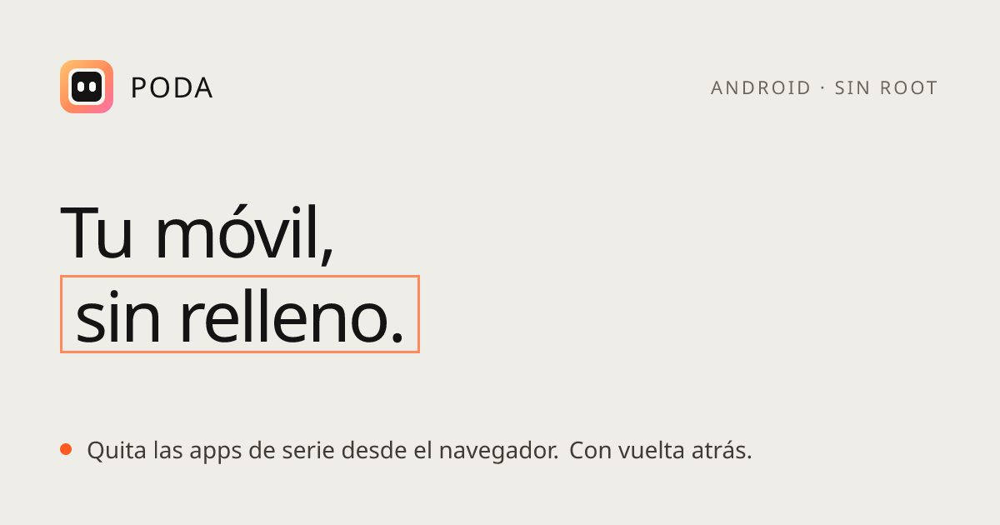
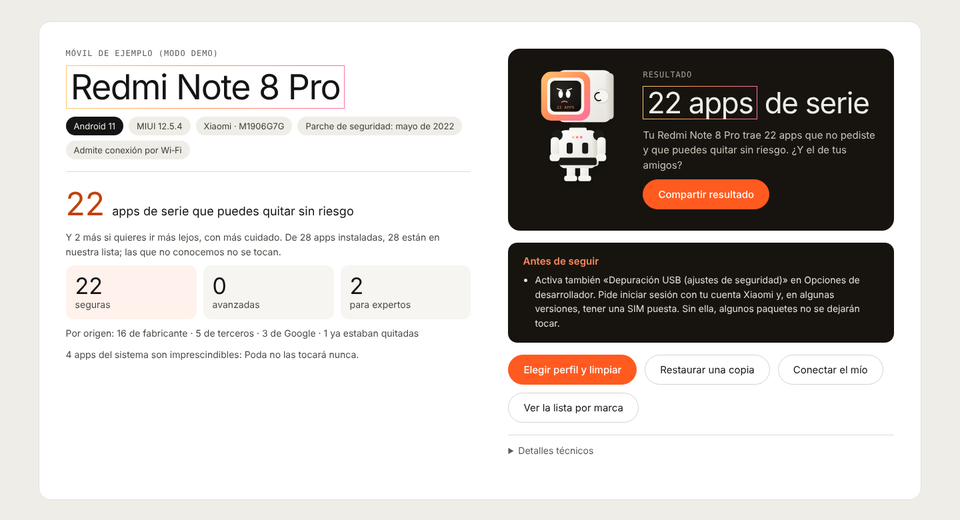
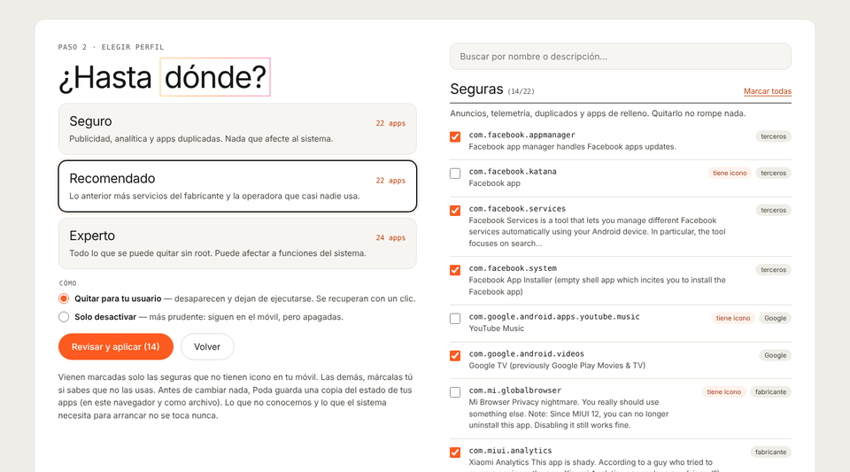
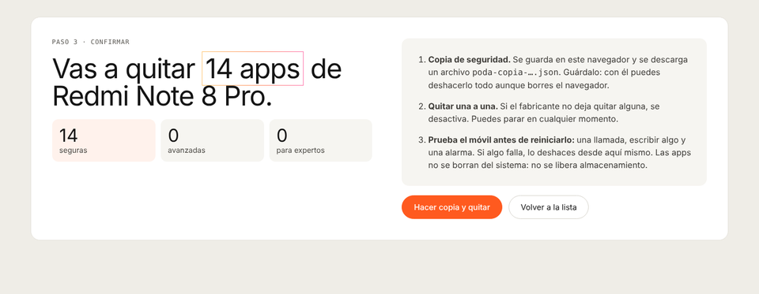
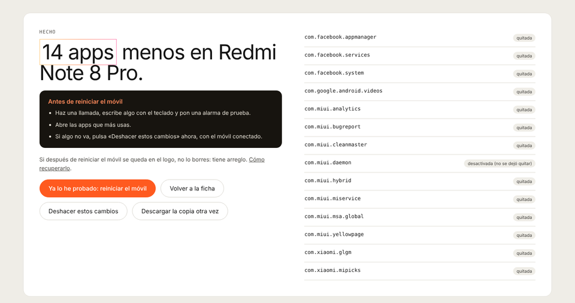
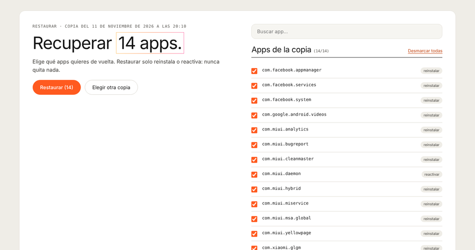
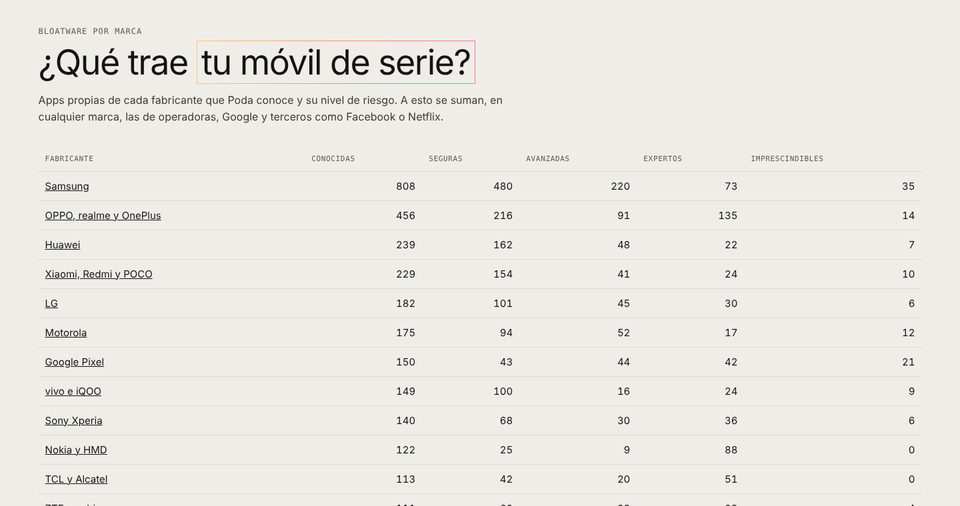

<p align="center">
  <a href="https://podamovil.com"></a>
</p>

<p align="center">
  <strong>Español</strong> · <a href="README.en.md">English</a>
</p>

<p align="center">
  <a href="LICENSE"></a>
  <a href="https://github.com/RedderLabs/PODA/actions/workflows/ci.yml"></a>
  <a href="https://github.com/RedderLabs/PODA/stargazers"></a>
  <a href="https://podamovil.com"></a>
  
</p>

# PODA

**P**rograma para **O**cultar y **D**esactivar **A**pps. Quita las apps que el fabricante y la operadora metieron de serie en tu Android: desde el navegador, sin instalar nada, sin root y con vuelta atrás.

> Poda no borra nada del sistema. Quita las apps **para tu usuario** (`pm uninstall -k --user 0`) o las desactiva. Todo se recupera con un clic o con un comando, y antes de cambiar nada se guarda una copia.

## Empieza aquí

| Tengo… | Ve a |
|---|---|
| Un Android y un ordenador con Chrome o Edge | **[podamovil.com/conectar](https://podamovil.com/conectar/)**: enchufa el cable y listo |
| Claude Code (u otro asistente que ejecute comandos) | **[El prompt](#con-claude-u-otro-asistente)**: pégalo y el asistente hace el resto |
| Android 11 o superior y ningún ordenador | **[Sin ordenador](https://podamovil.com/sin-pc/)**: Shizuku + Canta, con la lista de Poda de lo que no se toca |
| Un iPhone | No se puede hacer lo mismo. Lo que sí se puede, en [COMPATIBILIDAD.md](COMPATIBILIDAD.md#apple-iphone-y-ipad) |
| Curiosidad | **[Bloatware por marca](https://podamovil.com/marcas/)**: qué trae cada fabricante y qué se puede quitar |

## Cómo funciona

1. **Activas la depuración USB** en el móvil (dos minutos, se desactiva al terminar).
2. **Lo conectas.** Chrome o Edge hablan con el móvil por el cable (WebUSB). Nada sale de tu ordenador.
3. **Poda lo reconoce**: modelo, versión de Android, capa del fabricante y cuántas apps de serie se pueden quitar.
4. **Eliges hasta dónde** (seguro, recomendado o experto), revisas la lista, se guarda una copia y se aplica.
5. **Pruebas el móvil y reinicias.** Si algo no va, se deshace desde la misma pantalla.

## Inicio rápido

### Desde el navegador

1. Abre **[podamovil.com/conectar](https://podamovil.com/conectar/)** en Chrome, Edge, Brave u Opera de escritorio.
2. En el móvil: Ajustes → Información del teléfono → pulsa 7 veces «Número de compilación». Luego, en Opciones de desarrollador, activa «Depuración USB».
3. Conecta el cable, pulsa **Conectar móvil** y acepta el aviso en el móvil.

¿Sin móvil a mano? Prueba el modo de ejemplo: [podamovil.com/conectar/?demo](https://podamovil.com/conectar/?demo).

### Con Claude (u otro asistente)

Pega esto en Claude Code:

```text
Clona https://github.com/RedderLabs/PODA y sigue las instrucciones de PROMPT.md.
Quiero limpiar mi móvil Android con el perfil recomendado.
Detecta la marca y el modelo, y enséñame la propuesta con cada paquete explicado en lenguaje normal.
Antes de tocar nada, guarda una copia para poder volver atrás.
No apliques ningún cambio hasta que yo lo confirme.
```

El asistente instala lo necesario (preguntando antes), conecta el móvil por cable o por Wi‑Fi y usa el servidor MCP de Poda, que se niega a aplicar nada sin copia previa ni confirmación. Las instrucciones completas que sigue están en [PROMPT.md](PROMPT.md).

### Desde la línea de comandos

```bash
git clone https://github.com/RedderLabs/PODA.git && cd PODA
pnpm install && pnpm build
node apps/mcp/dist/cli.js ayuda
```

## Qué consigues

| | |
|---|---|
| <br>**Tu móvil, reconocido.** Modelo, Android, capa y cuántas apps sobran. | <br>**Tú decides hasta dónde.** Por defecto solo van marcadas las seguras sin icono. |
| <br>**Copia antes de nada.** Se guarda en el navegador y se descarga como archivo. | <br>**Prueba y reinicia.** Si algo no va, se deshace desde aquí. |
| <br>**Vuelta atrás, app a app.** Restaurar solo devuelve: nunca quita nada. | <br>**Bloatware por marca.** Qué trae cada fabricante y su nivel de riesgo. |

## Móviles compatibles

Cualquier Android 5.0 o superior que acepte depuración USB. Poda no depende del modelo: cruza las apps de tu móvil con una lista de unas **5.400 apps conocidas** y deja sin tocar las que no conoce.

| Fabricante | Apps propias conocidas | Seguras | Avanzadas | Expertas | Nunca se tocan |
|---|---:|---:|---:|---:|---:|
| Samsung (One UI) | 808 | 480 | 220 | 73 | 35 |
| OPPO, realme y OnePlus | 456 | 216 | 91 | 135 | 14 |
| Huawei (EMUI / HarmonyOS 4 o anterior) | 239 | 162 | 48 | 22 | 7 |
| Xiaomi, Redmi y POCO (HyperOS / MIUI) | 229 | 154 | 41 | 24 | 10 |
| Motorola | 175 | 94 | 52 | 17 | 12 |
| Google Pixel | 150 | 43 | 44 | 42 | 21 |

Y además LG, vivo, Sony, Nokia, TCL, ZTE, Transsion, ASUS, Honor, Lenovo, Meizu, Nothing y Blackview. A todas se suman las apps de operadoras, Google y terceros (Facebook, Netflix…). Tabla completa, requisitos y avisos por marca en **[COMPATIBILIDAD.md](COMPATIBILIDAD.md)**.

No es compatible: iPhone y iPad (iOS no lo permite) ni Huawei con HarmonyOS NEXT (ya no es Android).

## Lo que Poda nunca toca

La lista de partida es la de [Universal Android Debloater Next Generation](https://github.com/Universal-Debloater-Alliance/universal-android-debloater-next-generation). Poda la endurece porque la usa gente que no es técnica:

- **Nunca se tocan:** arranque y ajustes del sistema, pantalla de inicio, asistente de configuración, llamadas, datos y operadora, y los servicios de Google de los que dependen otras apps.
- **Solo en el perfil experto, con aviso:** teclado, llamadas, SMS, contactos, reloj, navegador, cámara y galería.
- **Por defecto, desmarcadas:** las apps con icono en tu móvil, porque puede que las uses.

La lista está en [`packages/nucleo/src/protecciones.ts`](packages/nucleo/src/protecciones.ts) y se publica abierta en [podamovil.com/protegidas.json](https://podamovil.com/protegidas.json) para que cualquier otra herramienta pueda usarla.

## A mano

Si prefieres hacerlo tú con [adb](https://developer.android.com/tools/releases/platform-tools):

```bash
adb shell pm list packages                                 # apps instaladas
adb shell pm uninstall -k --user 0 com.ejemplo.app          # quitar para tu usuario
adb shell pm disable-user --user 0 com.ejemplo.app          # o solo desactivar
adb shell cmd package install-existing --user 0 com.ejemplo.app   # volver a ponerla
adb shell pm enable --user 0 com.ejemplo.app                # volver a activarla
```

Restaurar todo desde una copia de Poda en Windows (PowerShell):

```powershell
$c = Get-Content "$HOME\Downloads\poda-copia-….json" -Raw | ConvertFrom-Json
$c.paquetes.PSObject.Properties | Where-Object { $_.Value -eq "instalado" -and $_.Name -like "*.*" } |
  ForEach-Object { adb shell cmd package install-existing --user 0 $_.Name; adb shell pm enable --user 0 $_.Name }
```

## Restaurar, actualizaciones y problemas

- **[Restaurar](docs/restaurar.md):** desde la web, desde el archivo de copia o a mano.
- **[Si el móvil se queda en el logo](docs/rescate.md):** se recupera sin borrar nada, por cable o desde el recovery.
- **[Después de una actualización del sistema](docs/actualizaciones.md):** algunas apps pueden volver.
- **[Problemas al conectar](docs/problemas.md):** el navegador no ve el móvil, «otro programa lo está usando», Xiaomi, Samsung…
- **[Sin ordenador](docs/sin-pc.md):** Android 11 o superior con Shizuku y Canta.

## Preguntas

**¿Puedo romper el móvil?** Poda nunca toca lo que el móvil necesita para arrancar, llamar o conectarse, y guarda una copia antes de cambiar nada. Aun así, ninguna lista es perfecta: por eso pide probar antes de reiniciar y tiene [guía de rescate](docs/rescate.md).

**¿Pierdo la garantía?** No. No hace falta root ni tocar el bootloader: solo se quitan apps para tu usuario, lo mismo que Android deja hacer con algunas desde Ajustes.

**¿Libera espacio?** No. Las apps siguen en la partición del sistema; lo que ganas es menos procesos en segundo plano, menos anuncios y menos rastreo.

**¿Se envían mis datos a algún sitio?** No. La conexión va del navegador al móvil por el cable y la lista de apps de tu móvil no sale de tu ordenador. La web no tiene cuentas ni cookies de seguimiento.

**¿Qué navegador necesito?** Chrome, Edge, Brave u Opera de escritorio. Firefox y Safari no tienen WebUSB.

Más en [docs/preguntas.md](docs/preguntas.md).

## Contribuir

Lo que más ayuda:

- **Contar cómo te fue con tu móvil** (marca, modelo, Android, perfil y resultado) en una [issue](https://github.com/RedderLabs/PODA/issues/new/choose).
- **Avisar de una app mal clasificada**: algo que Poda propone y no debería, o al revés.
- **Traducir descripciones** de apps al español.

Lee [CONTRIBUTING.md](CONTRIBUTING.md) antes de abrir un PR. Si eres un asistente de IA trabajando en el código, lee [AGENTS.md](AGENTS.md).

## Desarrollo

Monorepo con Turborepo y pnpm: `apps/web` (Next.js, web estática), `apps/mcp` (servidor MCP y línea de comandos) y `packages/nucleo` (reglas comunes). Cómo arrancarlo, la estructura y cómo publicarlo: **[docs/desarrollo.md](docs/desarrollo.md)**.

## Contacto

- Novedades: [@redderlabs en X](https://x.com/redderlabs) · [redderlabs.com](https://redderlabs.com)
- Dudas y propuestas: [Discussions](https://github.com/RedderLabs/PODA/discussions)
- Errores y móviles probados: [Issues](https://github.com/RedderLabs/PODA/issues)
- Seguridad: [SECURITY.md](SECURITY.md)

## Aviso legal

Poda se ofrece tal cual, sin garantías. Cambiar apps del sistema puede afectar al funcionamiento del móvil: úsalo bajo tu responsabilidad, guarda la copia y prueba antes de reiniciar. Poda no está afiliado ni respaldado por Google, Samsung, Xiaomi ni ningún otro fabricante u operadora; sus nombres y marcas se usan solo para identificar los dispositivos compatibles.

## Licencia

[GPL‑3.0 o posterior](LICENSE). La lista de apps procede de [Universal Android Debloater Next Generation](https://github.com/Universal-Debloater-Alliance/universal-android-debloater-next-generation) (GPL‑3.0); gracias a su comunidad por mantenerla. La conexión por WebUSB usa [Tango (ya-webadb)](https://github.com/yume-chan/ya-webadb).

---

<p align="center">Un producto de <a href="https://redderlabs.com">Redder Labs</a></p>
