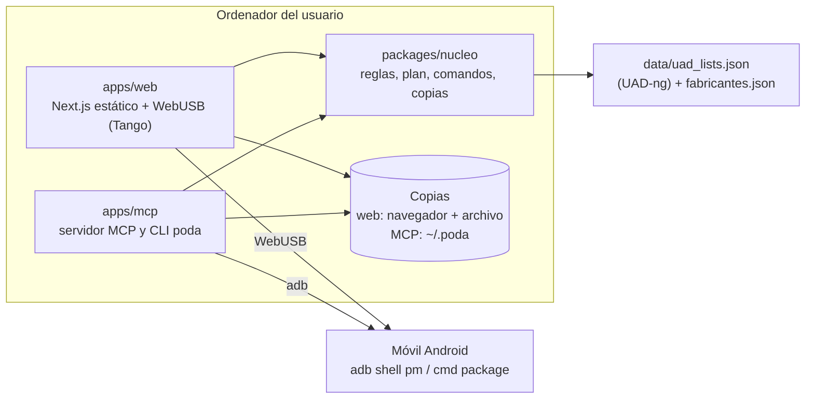

# Arquitectura

Estado: describe Poda tal como está hoy. El detalle de carpetas, comandos y despliegue está en [docs/desarrollo.md](../docs/desarrollo.md).

## Piezas

## Contratos internos

`@poda/nucleo` es el contrato entre las vías. Lo que deben compartir:

| Concepto | Función del núcleo |
|---|---|
| Nivel final de un paquete | `nivelDe` → `ajustarNivel` (aplica `PROTEGIDOS` y `AVISO_PODA`) |
| Paquete protegido | `estaProtegido` |
| Nombre válido (evita inyección) | `esPaqueteValido`, `COMANDOS.*` |
| Estado de los paquetes | `estadosDe` |
| Qué entra en un perfil | `planDePerfil` |
| Lectura de respuestas del móvil | `RESPUESTA_OK` |
| Formato de la copia | `CopiaEstado`, `crearCopiaEstado`, `leerCopiaEstado` |
| Qué hace restaurar | `pasosParaRestaurar` |

La web y el MCP usan todas estas funciones (desde la especificación [001](001-mismas-reglas-en-todas-las-vias/spec.md)). Una vía nueva no debe reimplementar ninguna.

## Datos

No hay base de datos. Datos que maneja Poda:

| Dato | Dónde vive | Sensible |
|---|---|---|
| Lista de apps y niveles | `data/uad_lists.json` (GPL-3.0), compactada en `lista.json` al compilar | No |
| Propiedades del móvil (`getprop`) | Memoria y copia | Sí: modelo, serie. No sale del ordenador |
| Estado de los paquetes | Memoria y copia | Sí: revela qué apps usa la persona |
| Copia (`CopiaEstado` v1) | Web: almacenamiento del navegador y archivo descargado. MCP: `~/.poda/copias/<serie>/` | Sí |
| Registro del MCP | `~/.poda` | Sí |

## Decisiones

| Decisión | Alternativa descartada | Motivo |
|---|---|---|
| Web estática (`output: "export"`) | Servidor Next.js | Nada sale del ordenador; se aloja en cualquier sitio con HTTPS |
| WebUSB con Tango (`@yume-chan/adb`) | Pedir instalar adb | Sin instalar nada para el flujo principal |
| `pm uninstall -k --user 0` | Root o borrar del sistema | Reversible con `install-existing` |
| Lista de UAD-ng endurecida en `protecciones.ts` | Lista propia desde cero | Aprovechar 5.400 apps conocidas; endurecer para público no técnico |
| Monorepo pnpm + Turborepo | Repositorios separados | Una sola fuente de reglas para las tres vías |

Las decisiones nuevas que sean caras de revertir se registran como ADR en `specs/adr/NNN-titulo.md`.
